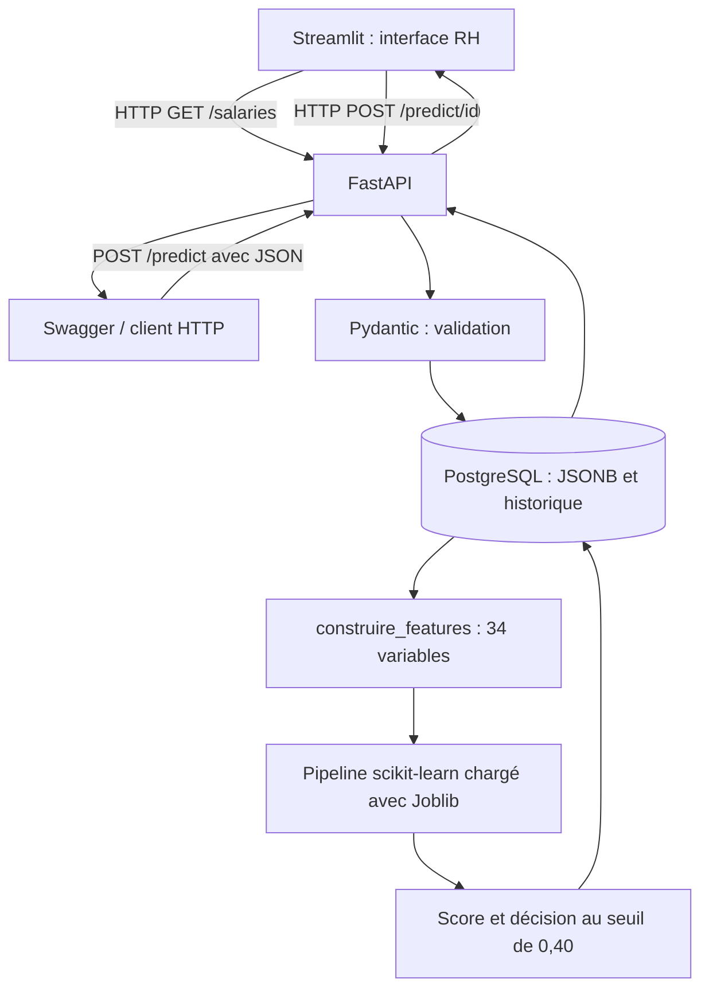
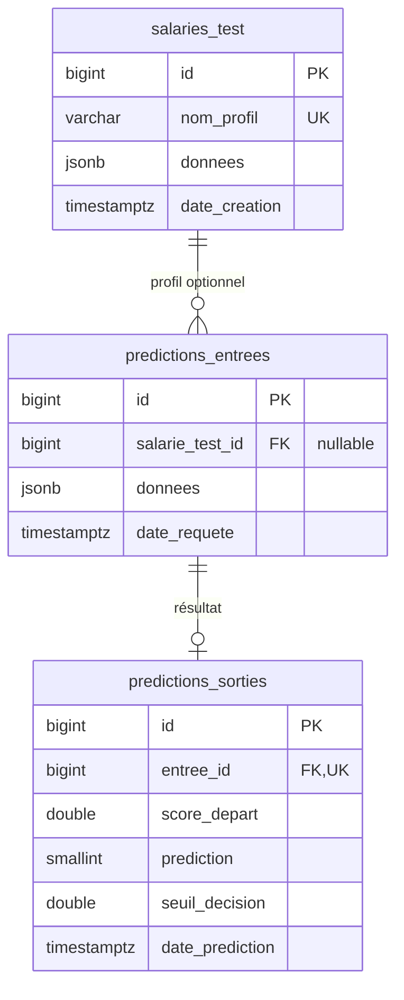

# Projet P5 — Prédiction de l'attrition des salariés

**Application de Machine Learning avec FastAPI, PostgreSQL, Streamlit et intégration continue GitHub Actions**

Ce projet, réalisé dans le cadre du parcours OpenClassrooms, transforme un modèle de classification de l'attrition des salariés en une application exploitable localement. Il permet de sélectionner un profil RH, d'estimer un risque de départ, d'enregistrer les interactions avec le modèle en base de données et de vérifier automatiquement la qualité du code avant son intégration dans la branche `main`.

> **Périmètre :** démonstrateur pédagogique reposant sur **10 profils synthétiques**, une API locale et un modèle entraîné lors du projet précédent (P4). Il ne s'agit ni d'un outil décisionnel RH autonome ni d'un déploiement de production.

## Sommaire

1. [Fonctionnalités](#1-fonctionnalités)
2. [Architecture et cheminement des données](#2-architecture-et-cheminement-des-données)
3. [Organisation du dépôt](#3-organisation-du-dépôt)
4. [Modèle de Machine Learning et Joblib](#4-modèle-de-machine-learning-et-joblib)
5. [Validation Pydantic et feature engineering](#5-validation-pydantic-et-feature-engineering)
6. [Base de données PostgreSQL et Psycopg](#6-base-de-données-postgresql-et-psycopg)
7. [Installation locale](#7-installation-locale)
8. [Initialisation de PostgreSQL et import des profils](#8-initialisation-de-postgresql-et-import-des-profils)
9. [Démarrage de FastAPI et Streamlit](#9-démarrage-de-fastapi-et-streamlit)
10. [Documentation des endpoints](#10-documentation-des-endpoints)
11. [Tests Pytest et couverture pytest-cov](#11-tests-pytest-et-couverture-pytest-cov)
12. [Intégration continue avec GitHub Actions](#12-intégration-continue-avec-github-actions)
13. [GitFlow et commits atomiques](#13-gitflow-et-commits-atomiques)
14. [Dépendances : rôle des bibliothèques](#14-dépendances--rôle-des-bibliothèques)
15. [Sécurité, limites et pistes d'évolution](#15-sécurité-limites-et-pistes-dévolution)
16. [Dépannage courant](#16-dépannage-courant)

## 1. Fonctionnalités

- **Prédiction unitaire par JSON** : envoi des caractéristiques d'un salarié à `POST /predict`.
- **Prédiction par identifiant** : sélection d'un salarié déjà enregistré via `POST /predict/{salarie_id}`.
- **Liste des profils disponibles** : consultation avec `GET /salaries`.
- **Validation des données** : schémas Pydantic, contraintes de types, modalités catégorielles et cohérence entre variables.
- **Préparation reproductible des variables** : reconstruction des 34 features attendues par le pipeline entraîné.
- **Persistance et traçabilité** : conservation des entrées et des sorties de prédiction dans PostgreSQL.
- **Interface graphique Streamlit** : sélection du salarié, déclenchement de la prédiction, affichage du score et des identifiants de traçabilité.
- **Documentation interactive Swagger/OpenAPI** : disponible depuis `/docs`.
- **Tests automatisés** : suite de **24 tests Pytest**, comprenant des tests unitaires, des tests HTTP et des tests d'intégration PostgreSQL.
- **Intégration continue** : vérification des tests sur GitHub Actions et contrôle obligatoire avant fusion dans `main`.

## 2. Architecture et cheminement des données



**Séparation des responsabilités :**

- **Streamlit** gère l'interface ; il consomme l'API HTTP mais n'accède pas directement au modèle ou à PostgreSQL.
- **FastAPI** orchestre la validation, le chargement des caractéristiques, la prédiction et la réponse HTTP.
- **Pydantic** valide les données reçues.
- **PostgreSQL** conserve les caractéristiques brutes et la traçabilité.
- **Pandas / NumPy** préparent les variables numériques et catégorielles.
- **scikit-learn** effectue le prétraitement appris et la prédiction.
- **Joblib** sérialise puis recharge le pipeline entraîné et ses métadonnées.

### Deux parcours de prédiction

**Depuis un identifiant PostgreSQL (`POST /predict/{salarie_id}`)** :

1. Vérifier que le salarié existe dans `salaries_test`.
2. Récupérer le JSONB correspondant et le valider avec Pydantic.
3. Insérer les caractéristiques dans `predictions_entrees`.
4. Construire les features et exécuter le pipeline scikit-learn.
5. Enregistrer le score et la classe dans `predictions_sorties`.
6. Retourner le résultat, ainsi que les identifiants d'entrée et de sortie.

**Depuis un JSON saisi (`POST /predict`)** :

1. Valider le JSON reçu avec Pydantic.
2. Insérer l'entrée dans PostgreSQL, avec `salarie_test_id = NULL`.
3. Relire cette entrée depuis la base de données.
4. Construire les features, calculer le score et enregistrer la sortie.
5. Retourner la réponse au format historique de l'API.

Les écritures d'une prédiction sont regroupées au sein d'une **transaction** : une exception déclenche normalement l'annulation des insertions de cette opération, afin d'éviter une entrée persistée sans résultat associé.

## 3. Organisation du dépôt

```text
OC_P5/
├── .github/
│   └── workflows/
│       └── ci-pytest-p5.yaml           # Workflow d'intégration continue
├── API_Attrition_Fastapi/
│   ├── app/
│   │   ├── main.py                     # Application et routes FastAPI
│   │   ├── schemas.py                  # Schémas Pydantic
│   │   ├── features.py                 # Construction des variables ML
│   │   ├── database.py                 # Connexion Psycopg
│   │   ├── profils_repository.py       # Accès SQL aux salariés
│   │   └── predictions_repository.py   # Persistance des prédictions
│   ├── interface/
│   │   └── streamlit_app.py            # Interface graphique
│   ├── models/
│   │   └── turnover_logistic.joblib    # Pipeline sérialisé
│   ├── notebooks/
│   │   └── notebook_corrige_features.ipynb
│   ├── scripts/
│   │   ├── test_connexion.py
│   │   └── import_profils.py
│   ├── sql/
│   │   ├── 01_schema_tests.sql
│   │   └── 02_consulter_profils.sql
│   └── tests/
│       ├── fixtures/                   # Dix profils JSON de démonstration
│       └── test_*.py                   # Tests Pytest
├── .env.example                        # Variables requises, sans secrets
├── .gitignore
├── pyproject.toml                      # Dépendances et configuration Poetry
├── poetry.lock                         # Verrouillage des dépendances
└── README.md
```

> L'arborescence décrit les composants construits au cours du projet. **Vérifier avant livraison** que l'artefact Joblib, les dix fixtures et `.env.example` sont effectivement présents dans la branche `main` ; les fichiers ignorés ou uniquement locaux ne sont pas transmis par Git.

## 4. Modèle de Machine Learning et Joblib

### 4.1 Origine du modèle

Le modèle a été entraîné dans le cadre du projet P4 sur des données RH d'une **entreprise de services du numérique (ESN)**. Il s'agit d'un problème de **classification binaire** :

- `0` : départ non détecté ;
- `1` : départ potentiel détecté.

Plusieurs modèles ont été comparés lors de la phase d'expérimentation. Le pipeline retenu pour l'application P5 est une **régression logistique scikit-learn** avec régularisation **L2**, `C = 0.01` et `class_weight = "balanced"`.

Le compromis métier privilégie le **rappel (recall)** afin de limiter les **faux négatifs**, c'est-à-dire les salariés susceptibles de partir mais non détectés. La métrique **F5** a également été étudiée, car elle accorde plus d'importance au rappel qu'à la précision. Le seuil de décision retenu est **`0.40`**, au lieu du seuil usuel de `0.50`.

### 4.2 Sérialisation avec Joblib

L'entraînement est effectué hors de l'API, dans un notebook. Le pipeline final est ensuite sauvegardé avec `joblib.dump()` :

```python
artefact = {
    "pipeline": modele_final_seuil_04,
    "seuil": float(seuil_metier),
    "features": list(X_train_brut.columns),
    "versions": {
        "python": platform.python_version(),
        "scikit_learn": sklearn.__version__,
        "pandas": pd.__version__,
        "numpy": np.__version__,
    },
}

joblib.dump(artefact, "models/turnover_logistic.joblib")
```

L'API recharge cet artefact au démarrage :

```python
artefact = joblib.load(CHEMIN_MODELE)
pipeline = artefact["pipeline"]
seuil = artefact["seuil"]
features = artefact["features"]
```

**Pourquoi Joblib ?** Il permet de conserver et de recharger un objet Python complexe, notamment un `Pipeline` scikit-learn comprenant les transformateurs appris, les coefficients du modèle et les métadonnées nécessaires à l'inférence. **Il n'est pas nécessaire de réentraîner le modèle à chaque lancement de FastAPI.**

**Précautions :** ne charger que des artefacts provenant d'une source fiable (le chargement utilise des mécanismes de désérialisation Python) et employer des versions de bibliothèques compatibles avec celles de l'entraînement. Les versions utilisées sont enregistrées dans les métadonnées de l'artefact.

### 4.3 Inférence

Le score est calculé avec :

```python
score = float(pipeline.predict_proba(X)[0, 1])
prediction = int(score >= seuil)
```

La classe `1` correspond à un score supérieur ou égal au seuil. Le score est une **estimation statistique** : il ne constitue pas une certitude de départ ni, sans vérification de calibration, une probabilité directement exploitable comme fréquence réelle.

## 5. Validation Pydantic et feature engineering

### 5.1 Contrat d'entrée

Le schéma `SalarieEntree` définit **30 caractéristiques brutes obligatoires**, couvrant notamment :

- l'âge, le genre, le revenu mensuel et la situation familiale ;
- le département et le poste ;
- l'expérience, l'ancienneté dans l'entreprise et dans le poste ;
- les évaluations et la satisfaction au travail ;
- les heures supplémentaires, les formations, les promotions et les déplacements.

Pydantic vérifie les **types**, les **bornes numériques**, les **catégories autorisées** et des règles de cohérence telles que :

```text
annees_dans_le_poste_actuel <= annees_dans_l_entreprise
annees_dans_l_entreprise <= annee_experience_totale
annees_depuis_la_derniere_promotion <= annees_dans_l_entreprise
```

Une requête invalide est refusée avec une réponse HTTP **422**. Les champs supplémentaires sont interdits par le schéma.

Certains noms de colonnes conservent volontairement l'orthographe présente dans les données d'entraînement, par exemple `augementation_salaire_precedente`, `annes_sous_responsable_actuel` et `nombre_heures_travailless`. Les renommer sans adapter le preprocessing casserait la compatibilité avec le modèle.

### 5.2 De 30 caractéristiques à 34 features

La fonction `construire_features(salarie, features)` transforme les variables brutes en un `DataFrame` Pandas, conforme à la liste et à l'ordre des **34 features** attendues par l'artefact.

Parmi les variables dérivées :

| Variable construite | Description |
|---|---|
| `augmentation_salaire_precedente_pct` | Conversion de la chaîne de pourcentage en valeur numérique |
| `ratio_anciennete_experience` | Ancienneté dans l'entreprise / expérience totale |
| `ratio_temps_poste_anciennete` | Durée dans le poste / ancienneté dans l'entreprise |
| `ratio_promotion_anciennete` | Temps depuis la dernière promotion / ancienneté |
| `revenu_par_annee_experience` | Revenu mensuel / années d'expérience |

Les divisions utilisent une petite constante numérique (`epsilon`) pour éviter une division directe par zéro ; cette convention doit **rester identique à celle de l'entraînement**.

Les transformations apprises à l'entraînement (par exemple encodage des catégories et mise à l'échelle) sont exécutées par le pipeline scikit-learn chargé depuis Joblib.

**Où sont stockées les features ?** PostgreSQL conserve les **caractéristiques brutes** et l'historique des prédictions ; les **34 features calculées** existent temporairement en mémoire Python au moment de l'inférence. Elles ne sont pas actuellement persistées comme une table distincte.

## 6. Base de données PostgreSQL et Psycopg

### 6.1 Pourquoi PostgreSQL ?

PostgreSQL fournit une base relationnelle robuste pour conserver les profils de démonstration et tracer les opérations de prédiction. Le type **`JSONB`** permet de stocker les caractéristiques variables des salariés sans définir une colonne SQL par caractéristique.

### 6.2 Schéma relationnel



| Table | Rôle | Contraintes principales |
|---|---|---|
| `salaries_test` | Conserve les dix profils synthétiques | `id` clé primaire ; `nom_profil` unique ; `donnees` JSONB |
| `predictions_entrees` | Journalise les caractéristiques de chaque appel | `id` clé primaire ; `salarie_test_id` clé étrangère nullable |
| `predictions_sorties` | Journalise score, classe et seuil | `entree_id` référence une entrée et possède une contrainte `UNIQUE` |

Un salarié peut être associé à **plusieurs prédictions**. Chaque sortie doit référencer **une entrée unique**. Une entrée peut avoir `salarie_test_id = NULL` lorsqu'elle vient directement d'un JSON envoyé à `/predict`.

### 6.3 Pourquoi Psycopg 3 ?

`psycopg` est le **pilote PostgreSQL de Python**. Il établit les connexions, transmet des requêtes paramétrées, gère les transactions et récupère les lignes SQL. L'adaptateur `psycopg.types.json.Jsonb` permet d'insérer proprement des dictionnaires Python dans les colonnes `JSONB`.

Exemple de requête paramétrée :

```python
curseur.execute(
    "SELECT donnees FROM salaries_test WHERE id = %s",
    (salarie_id,),
)
```

L'utilisation de paramètres évite de concaténer directement une valeur utilisateur dans le texte SQL. Le projet accède aux données à travers les fonctions des fichiers `profils_repository.py` et `predictions_repository.py` ; il n'utilise pas d'ORM pour cette couche.

### 6.4 Bases de développement et de test

- `attrition_rh` : profils et prédictions du développement local.
- `attrition_rh_test` : schéma indépendant utilisé pour les tests d'intégration.

Les tests d'intégration emploient une connexion isolée avec **rollback** afin de ne pas polluer les données de développement.

## 7. Installation locale

### 7.1 Prérequis

- **Windows 11** avec **PowerShell** et **VS Code** (environnement utilisé pendant le projet) ;
- **Git** ;
- **Python 3.14** dans l'environnement utilisé lors du développement, sous réserve de compatibilité avec les versions verrouillées de l'artefact Joblib ;
- **Poetry** pour gérer l'environnement et les dépendances ;
- **PostgreSQL** avec le client `psql` accessible dans `PATH`.

Les versions réellement utilisées et verrouillées sont définies dans `pyproject.toml` et `poetry.lock` : elles font foi pour la reproductibilité.

### 7.2 Cloner le dépôt

```powershell
git clone https://github.com/Johndesfr/OC_P5.git
cd OC_P5
```

### 7.3 Installer les dépendances

Depuis **la racine du dépôt**, là où se trouve `pyproject.toml` :

```powershell
poetry install --no-root
```

Cela installe les dépendances du projet dans l'environnement virtuel géré par Poetry, y compris les outils de test appartenant au groupe de développement si ce groupe est activé dans ta configuration Poetry.

Pour contrôler l'environnement :

```powershell
poetry run python --version
poetry run python -c "import fastapi, psycopg, joblib, streamlit; print('OK')"
```

### 7.4 Configurer les variables d'environnement

À la racine `OC_P5/`, créer le fichier **`.env`** :

```dotenv
DB_HOST=127.0.0.1
DB_PORT=5432
DB_NAME=attrition_rh
DB_USER=postgres
DB_PASSWORD=REMPLACER_PAR_LE_MOT_DE_PASSE_LOCAL
```

Le module `app/database.py` utilise `python-dotenv` pour charger ce fichier. La configuration de Streamlit peut utiliser `API_BASE_URL` (par défaut `http://127.0.0.1:8000`).

**Ne jamais commiter `.env`**, un véritable mot de passe ou des données RH identifiantes. Conserver uniquement un `.env.example` avec des valeurs fictives. Les fichiers `.coverage`, `htmlcov/`, les caches Python et le répertoire `.venv/` doivent également rester hors du dépôt.

## 8. Initialisation de PostgreSQL et import des profils

### 8.1 Créer les bases

Depuis PowerShell :

```powershell
psql -U postgres -h 127.0.0.1 -d postgres -c "CREATE DATABASE attrition_rh;"
psql -U postgres -h 127.0.0.1 -d postgres -c "CREATE DATABASE attrition_rh_test;"
```

Ces commandes ne doivent être exécutées **qu'une fois** : PostgreSQL signalera une erreur si une base existe déjà.

### 8.2 Créer les tables

Depuis le sous-dossier de l'API :

```powershell
cd API_Attrition_Fastapi
psql -U postgres -h 127.0.0.1 -d attrition_rh -v ON_ERROR_STOP=1 -f .\sql\01_schema_tests.sql
psql -U postgres -h 127.0.0.1 -d attrition_rh_test -v ON_ERROR_STOP=1 -f .\sql\01_schema_tests.sql
```

Le script utilise `CREATE TABLE IF NOT EXISTS`, ce qui permet de le réexécuter sans recréer les tables déjà présentes.

### 8.3 Tester la connexion Python

```powershell
poetry run python -m scripts.test_connexion
```

La sortie doit mentionner la base `attrition_rh` et les trois tables SQL.

### 8.4 Importer les dix profils JSON

```powershell
poetry run python -m scripts.import_profils
```

Le script lit les fichiers `tests/fixtures/*.json`, les valide avec `SalarieEntree`, puis insère leurs données dans `salaries_test` via `Jsonb`. La clause SQL **`ON CONFLICT (nom_profil) DO NOTHING`** évite de créer des doublons lorsque l'import est relancé.

Vérifier le nombre de profils :

```powershell
psql -U postgres -h 127.0.0.1 -d attrition_rh -c "SELECT COUNT(*) FROM salaries_test;"
```

**Résultat attendu : 10** (sur une base initialement vide et après un import réussi).

Inspecter les profils :

```powershell
psql -U postgres -h 127.0.0.1 -d attrition_rh -f .\sql\02_consulter_profils.sql
```

## 9. Démarrage de FastAPI et Streamlit

Utiliser **deux terminaux PowerShell distincts** dans VS Code, depuis `API_Attrition_Fastapi/`.

**Terminal 1 — API FastAPI** :

```powershell
poetry run uvicorn app.main:app --reload
```

Adresses :

- API : <http://127.0.0.1:8000>
- Swagger / OpenAPI : <http://127.0.0.1:8000/docs>
- Vérification de santé : <http://127.0.0.1:8000/health>

**Terminal 2 — Interface Streamlit** :

```powershell
poetry run streamlit run interface/streamlit_app.py
```

Interface : <http://localhost:8501>

Depuis Streamlit, sélectionner l'un des dix profils par son **ID PostgreSQL**, cliquer sur **Calculer la prédiction** et consulter :

- le score estimé de départ ;
- le seuil de décision de 40 % ;
- la classe prédite et son interprétation ;
- l'identifiant de l'entrée et celui de la sortie persistées.

Streamlit transmet ses requêtes à FastAPI avec la bibliothèque **Requests**. Les prédictions répétées créent de nouvelles entrées dans l'historique SQL, même pour le même salarié.

## 10. Documentation des endpoints

| Méthode | Route | Fonction |
|---|---|---|
| `GET` | `/health` | Vérification élémentaire du service |
| `GET` | `/model-info` | Informations sur le modèle chargé, le nombre de features et le seuil |
| `GET` | `/salaries` | Liste des profils stockés en base |
| `POST` | `/predict` | Prédiction depuis un JSON complet, avec persistance |
| `POST` | `/predict/{salarie_id}` | Prédiction depuis un profil existant, avec persistance |

### 10.1 Exemples de réponses

**`GET /health`** :

```json
{"status": "ok"}
```

**`GET /salaries`** (exemple illustratif) :

```json
[
  {"id": 1, "nom_profil": "profil_01", "poste": "Consultant"},
  {"id": 2, "nom_profil": "profil_02", "poste": "Tech Lead"}
]
```

**`POST /predict/{salarie_id}`** (exemple illustratif ; les scores réels sont calculés par le modèle) :

```json
{
  "salarie_id": 1,
  "entree_id": 15,
  "sortie_id": 15,
  "score_depart": 0.76,
  "prediction": 1,
  "interpretation": "Départ potentiel détecté",
  "seuil_decision": 0.4
}
```

**`POST /predict`** renvoie le format métier de sortie sans les identifiants de traçabilité :

```json
{
  "score_depart": 0.76,
  "prediction": 1,
  "interpretation": "Départ potentiel détecté",
  "seuil_decision": 0.4
}
```

Les identifiants de la requête JSON sont néanmoins enregistrés dans PostgreSQL et peuvent être retrouvés par une requête SQL.

### 10.2 Exemple d'appel PowerShell par identifiant

```powershell
Invoke-RestMethod -Method Post -Uri "http://127.0.0.1:8000/predict/1"
```

Pour une prédiction JSON complète, utiliser Swagger et l'un des dix fichiers de `tests/fixtures/` comme exemple de corps de requête : le contrat de l'API impose **30 champs** et les catégories exactes prévues dans `schemas.py`.

### 10.3 Codes HTTP utiles

- `200` : prédiction ou consultation réussie.
- `404` : identifiant salarié absent de `salaries_test`.
- `422` : validation Pydantic échouée ou format d'entrée incorrect.
- `500` : erreur interne non gérée, à diagnostiquer dans les logs FastAPI.

### 10.4 Vérifier la traçabilité

```sql
SELECT
    e.id AS entree_id,
    e.salarie_test_id,
    o.score_depart,
    o.prediction,
    o.seuil_decision
FROM predictions_entrees AS e
JOIN predictions_sorties AS o ON o.entree_id = e.id
ORDER BY e.id DESC
LIMIT 10;
```

Une entrée avec `salarie_test_id IS NULL` provient du chemin JSON direct ; une entrée avec cet identifiant renseigné provient d'un profil existant.

## 11. Tests Pytest et couverture pytest-cov

Le dossier `tests/` contient les tests unitaires, les tests HTTP réalisés avec **FastAPI TestClient** et les tests d'intégration avec une véritable base PostgreSQL dédiée.

### 11.1 Exécuter la suite

Depuis `API_Attrition_Fastapi/` :

```powershell
poetry run python -m pytest tests -v
```

**État validé pendant le projet : 24 tests réussis.** Les tests doivent être réexécutés après toute modification du code ou des dépendances.

### 11.2 Mesurer la couverture du code applicatif

```powershell
poetry run python -m pytest tests --cov=app --cov-branch --cov-report=term-missing
```

- `tests` indique **où Pytest cherche les tests**.
- `--cov=app` indique **quel code est mesuré** : le dossier `app/`, et non les fichiers de `tests/`.
- `--cov-branch` inclut la mesure des différents chemins conditionnels (`if`, `else`, etc.). Il ne désigne **pas** les branches Git.
- `--cov-report=term-missing` affiche les lignes non couvertes dans le terminal.

La mesure obtenue au cours du projet est de **92 % de couverture de `app/`**, avec analyse des branches. Ce taux ne garantit pas à lui seul l'absence de défauts : il complète les assertions et les tests d'intégration.

### 11.3 Générer le rapport HTML

```powershell
poetry run python -m pytest tests --cov=app --cov-branch --cov-report=html
Invoke-Item .\htmlcov\index.html
```

Les fichiers de couverture générés (`.coverage`, `htmlcov/`, `coverage.xml`) sont destinés au diagnostic et sont normalement ignorés par Git.

### 11.4 Tester PostgreSQL sans modifier les données de développement

La base `attrition_rh_test` possède le même schéma que `attrition_rh`. Les tests d'intégration utilisent des transactions **annulées après les assertions**. Ils vérifient notamment l'association entre une entrée de prédiction, le salarié concerné et la sortie calculée.

## 12. Intégration continue avec GitHub Actions

Le workflow est défini dans :

```text
.github/workflows/ci-pytest-p5.yaml
```

Il a pour objectif de vérifier automatiquement les tests avant la fusion de `develop` dans `main`.

### 12.1 Déclencheurs

```yaml
on:
  push:
    branches: [develop]
  pull_request:
    branches: [main]
```

- Un **push sur `develop`** lance la CI.
- Une **Pull Request ciblant `main`** lance la CI avant la fusion.
- Un **push direct sur `main`** n'est pas couvert par ces déclencheurs, sauf évolution future du YAML.

### 12.2 Étapes du pipeline

Le workflow prépare un environnement Linux temporaire, installe Python et les dépendances Poetry, démarre PostgreSQL en service de CI, initialise le schéma et les données nécessaires, puis exécute les tests.

La commande de validation comprend notamment :

```bash
poetry run python -m pytest tests -v -W ignore \
  --cov=app --cov-branch --cov-report=term-missing \
  --cov-fail-under=0 --junitxml=pytest-results.xml
```

- `-W ignore` **ignore les avertissements Python** ; les assertions en échec et les exceptions restent bloquantes.
- `--cov-fail-under=0` **n'impose aucun seuil minimal de couverture** pour la fusion.
- Le rapport JUnit permet au workflow de vérifier le nombre de tests réellement exécutés.

Le workflow a été conçu pour **exiger 24 tests exécutés avec succès, sans test ignoré**. Une modification du nombre de tests nécessitera d'adapter cette règle si elle reste fixée à 24.

### 12.3 Protection de la branche `main`

Une **ruleset GitHub** impose une Pull Request et la réussite du statut du job Pytest avant toute fusion dans `main`. Cette configuration est indépendante du YAML : **un workflow qui échoue ne bloque pas à lui seul un merge sans protection de branche**.

Le projet a validé une exécution réussie des tests sur GitHub Actions, puis une fusion de `develop` dans `main`.

### 12.4 CI n'est pas CD

La chaîne actuelle réalise de l'**intégration continue (CI)**, pas un déploiement automatique. Elle ne déploie pas FastAPI, PostgreSQL ou Streamlit sur un serveur distant. Une éventuelle étape de **CD** nécessiterait une cible de déploiement et une gestion adaptée des secrets.

## 13. GitFlow et commits atomiques

Le travail a été organisé selon une démarche inspirée de **GitFlow** :

- `main` : branche de référence stable ;
- `develop` : branche d'intégration ;
- `feature/*` : développements isolés (`feature/postgresql`, `feature/interface-streamlit`, `feature/github-actions-ci`, etc.).

Chaque commit doit apporter un **changement cohérent et réversible** : schéma SQL, module de connexion, import des profils, endpoint, tests, interface ou workflow CI.

Exemples de conventions de messages :

```text
feat(db): creation du schema PostgreSQL
feat(api): prediction par identifiant avec persistance PostgreSQL
test(db): verification de la persistance PostgreSQL
feat(ui): interface Streamlit de prediction par salarie
ci: validation automatique des tests Pytest avant fusion dans main
```

**Flux de développement :** branche `feature` → Pull Request vers `develop` → tests → Pull Request `develop` vers `main` → contrôle obligatoire de la CI → fusion.

Pour versionner ce README comme une modification documentaire autonome :

```powershell
git switch develop
git switch -c docs/readme-p5
# Ajouter ou modifier README.md
git add README.md
git diff --cached
git commit -m "docs: documentation complete du projet P5"
git push -u origin docs/readme-p5
```

Il restera à créer une Pull Request vers `develop`, puis à utiliser le processus de validation habituel avant une nouvelle fusion dans `main`.

## 14. Dépendances : rôle des bibliothèques

| Outil ou bibliothèque | Utilisation dans le projet |
|---|---|
| **Python** | Langage de programmation de l'API, du modèle et de l'interface |
| **Poetry** | Environnement virtuel, résolution et verrouillage des dépendances (`pyproject.toml`, `poetry.lock`) |
| **FastAPI** | Création des routes HTTP de prédiction et consultation |
| **Uvicorn** | Serveur ASGI exécutant FastAPI |
| **Pydantic** | Validation stricte des données d'entrée et de sortie |
| **Pandas** | Création du DataFrame de features ordonné |
| **NumPy** | Calcul numérique et constante `epsilon` dans le feature engineering |
| **scikit-learn** | Pipeline de preprocessing et modèle de régression logistique |
| **Joblib** | Sérialisation/désérialisation du pipeline entraîné |
| **PostgreSQL** | Stockage relationnel des profils, des requêtes et des résultats |
| **Psycopg 3** | Connexion Python–PostgreSQL, requêtes SQL, JSONB et transactions |
| **python-dotenv** | Chargement des paramètres locaux depuis `.env` |
| **Streamlit** | Interface graphique de démonstration |
| **Requests** | Appels HTTP de Streamlit vers FastAPI |
| **Pytest** | Exécution des tests unitaires et d'intégration |
| **pytest-cov / coverage.py** | Mesure de couverture de lignes et de branches |
| **HTTPX / TestClient** | Tests HTTP automatisés de FastAPI |
| **Git / GitFlow** | Gestion des versions, branches et intégrations |
| **GitHub Actions** | Automatisation des tests dans la CI |
| **Jupyter Notebook** | Expérimentation et entraînement du modèle dans le projet P4 |

La liste exacte et les versions installées dépendent du fichier `pyproject.toml` et du verrouillage `poetry.lock` du dépôt.

## 15. Sécurité, limites et pistes d'évolution

### Limites connues

1. **Jeu de démonstration limité** : dix profils JSON synthétiques sont importés dans PostgreSQL. L'import complet des jeux de données RH sources du P4 n'est pas implémenté dans ce périmètre.
2. **Application locale** : aucun déploiement continu sur une infrastructure distante n'est mis en œuvre.
3. **Pas de contrôle d'accès utilisateur documenté** : les endpoints et l'interface doivent rester dans un environnement local de confiance ; une exposition publique nécessiterait authentification, autorisations et sécurisation réseau.
4. **Modèle figé à l'entraînement** : les changements de schéma, de catégories ou de version de scikit-learn exigent des contrôles de compatibilité avec l'artefact Joblib.
5. **Certaines modalités sont limitées par le jeu d'entraînement** : par exemple, `ayant_enfants` était représenté uniquement par `"Y"` dans la configuration Pydantic discutée durant le projet.
6. **Features calculées non journalisées séparément** : l'historique conserve les caractéristiques brutes, le score et le seuil, mais pas une copie dédiée des 34 features reconstituées.

### Précautions RH et données personnelles

Une prédiction d'attrition est une indication statistique, **pas une preuve qu'une personne démissionnera**. Le score ne doit pas servir seul à prendre des décisions individuelles défavorables. Avant toute exploitation réelle, prévoir une évaluation de la discrimination et des biais, une validation métier, la sécurité des données personnelles, la gestion des durées de conservation et les obligations applicables au traitement de données RH.

Le projet utilise des **profils synthétiques** pour sa démonstration. Aucun fichier `.env` contenant un secret et aucune donnée RH réelle ne doivent être publiés dans le dépôt.

### Évolutions envisageables (hors périmètre livré)

- authentification et rôles d'accès ;
- supervision, logs et gestion détaillée des erreurs ;
- calibration et suivi de dérive du modèle ;
- tests de performance et de sécurité ;
- déploiement distant automatisé (CD) ;
- migration de schéma et sauvegarde PostgreSQL ;
- stockage versionné des features réellement utilisées pour chaque inférence.

## 16. Dépannage courant

| Symptôme | Cause probable | Vérification ou solution |
|---|---|---|
| `KeyError: 'DB_USER'` | `.env` absent, non sauvegardé ou mal placé | Vérifier le fichier à la racine `OC_P5/.env` et les variables `DB_*` |
| `ImportError: cannot import name 'ouvrir_connexion'` | Fonction absente ou fichier `database.py` non enregistré | Vérifier `app/database.py` et sauvegarder dans VS Code |
| `psql` non reconnu dans PowerShell | Répertoire `bin` de PostgreSQL absent du `PATH` | Ajouter le dossier contenant `psql.exe` au `PATH` utilisateur |
| HTTP `404` sur `/predict/{id}` | Identifiant inexistant | Vérifier la liste retournée par `GET /salaries` |
| HTTP `422` | JSON non conforme à `SalarieEntree` | Contrôler les 30 champs, types, catégories et bornes |
| `construire_features()` : argument manquant | Liste des features oubliée | Appeler `construire_features(salarie, features)` |
| `Address already in use` | Port 8000 ou 8501 déjà occupé | Arrêter l'ancien processus Uvicorn ou Streamlit |
| Échec des tests PostgreSQL | Base ou tables de test absentes | Créer `attrition_rh_test` et appliquer le script SQL |
| Workflow invisible dans GitHub | Chemin invalide | Vérifier `.github/workflows/` **avec le point initial** |
| `git push` rejeté (`non-fast-forward`) | Dépôt local en retard sur GitHub | `git fetch origin` puis intégrer les commits distants ; éviter `--force` |

---

## Contexte et objectif pédagogique

Le projet illustre le passage d'un **prototype de Machine Learning** à une **application intégrée et testable**. Il met en pratique la sérialisation d'un pipeline scikit-learn, la validation d'une API, la persistance relationnelle, une interface utilisateur et la sécurisation des fusions Git par intégration continue.

**Livrables principaux :** modèle Joblib, code FastAPI et Streamlit, schéma et scripts PostgreSQL, fixtures synthétiques, suite Pytest, couverture du code et workflow GitHub Actions.
